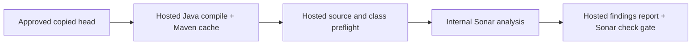

# Sonar check

Sonar runs for approved PR commits. Each new commit needs approval; title or
target-branch changes require rerunning the approved workflow.



Selection checks the full PR diff, including deleted/renamed paths. Supported
source and script changes trigger a scan, including GPU CI and other workflow
helpers. Among workflow YAML files, only `.github/workflows/sonar-check.yml` triggers Sonar.
Other workflow YAML, documentation and Dockerfile changes alone skip Sonar.

[sonar-paths.json](../../sonar-paths.json) controls supported source formats and
scanner inclusions: Java/Scala, C/C++, scripts, XML/HTML, workflow YAML and enabled
Text/secrets formats. Workflow YAML remains part of a selected scan.
Vendored/generated files, CUDA and generic JSON/YAML are excluded. A `[skip ci]`
title or an unaffected diff also skips Sonar.

## Results

| Result | Gate | PR comment |
| --- | --- | --- |
| Title CI-skip or unaffected diff | Skipped | None |
| Clean analysis | Success | None |
| Non-blocking findings | Success | Findings summary |
| High/Blocker issues or failed quality gate | Failure | Findings summary |
| Compilation, infrastructure or reporting error | Failure | None |

## Configuration and trust

- Requires repository secrets `SONAR_HOST_URL` and `SONAR_TOKEN`, plus variable
  `SONAR_PROJECT_KEY`. The project's quality gate must reject new High/Blocker issues.
- `SONAR_BUILD_JAVA_VERSION` optionally overrides hosted Java 17; scanner tooling
  comes from the internal runner image.
- Hosted compilation saves `~/.m2/repository` to a dedicated cache on the copied
  PR branch. Later runs reuse it when the pom and compile script match. An exact
  hit skips the upload.

Approval covers the copied workflow and helpers. Maven runs on a disposable hosted
runner without Sonar credentials. Fresh hosted preflight rejects source symlinks
and unsafe class artifacts before internal scanning, which reads source/classes as
data with step-scoped credentials. Preflight is heuristic; runner labels do not
restrict access from other workflows.

The workflow rechecks the PR head and target before scanning and passing the gate.
Same-PR scans serialize through collection without cancelling active scans.
Validate the workflow before making **Sonar check gate** required.

## Selector tests

CPU CI runs the selector regression tests when its helpers, catalog or workflow
change. Run them locally with Node.js 24 or newer:

```sh
node --test .github/scripts/sonar-check/test/*.test.js
```
