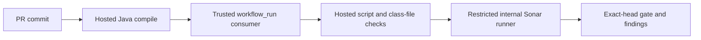

# Sonar check

PRs targeting `main` or `release/26.12` start **Sonar preparation** on opening,
reopening and new commits, like CPU CI. Title and target edits take effect on the
next such event. A title CI-skip marker or an unaffected diff skips analysis.

The PR workflow has read-only access and no Sonar credentials. The consumer runs
from `main`, independently verifies the producing run and current PR, and accepts
only bounded class-file artifacts from that run. It never executes PR build
scripts internally. Trusted helpers provide scanner settings and fresh scratch
space; the shared Common actions collect and report the exact analysis.

## Results

**Sonar check gate** is a custom check on the PR head, separate from the native
`workflow_run` jobs. A new commit waits for the required gate while preparation
runs. The trusted consumer creates it on completion, then reports the scan
outcome. A same-commit rerun retains the previous gate until preparation completes.
Same-commit gate updates serialize; superseded runs cannot overwrite the newer gate. Rerun
**Sonar preparation** to retry the whole path. An executing scan is not cancelled
by newer work; same-PR scans serialize through result collection.

| Result | Gate | PR comment |
| --- | --- | --- |
| Title skip or unaffected diff | Skipped | None |
| Clean analysis | Success | None |
| Non-blocking findings | Success | Findings summary |
| High/Blocker issues or failed quality gate | Failure | Findings summary |
| Preparation, infrastructure or reporting error | Failure | None |

## Affected files

[sonar-paths.json](../../sonar-paths.json) drives both selection and scanner
inclusions. Selection checks the complete diff, including deleted and renamed
paths. It includes Java/Scala, C/C++ and headers, supported script languages,
XML/HTML, Dockerfiles, workflow YAML and formats supported by the enabled
Text/secrets analyzer. Vendored dependencies and generated output are excluded.

The current server does not analyze Markdown, plain documentation, CUDA
`.cu`/`.cuh`, or generic JSON/YAML. Update the catalog when enabling another
analyzer. The separate script preflight is heuristic, not proof of safe code.

## Configuration

- Reuse `SONAR_HOST_URL` and `SONAR_TOKEN`; set `SONAR_PROJECT_KEY` to the existing
  JNI project. Its quality gate must reject new High and Blocker issues.
- `SONAR_BUILD_JAVA_VERSION` optionally overrides the hosted Java 17 default.
  Scanner tooling comes from the internal runner image.
- Set `SONAR_RUNNER_GROUP` to `org/<name>` only after that organization group is
  restricted to JNI and
  `NVIDIA/cudf-spark-jni/.github/workflows/sonar-scan.yml@refs/heads/main`.
  Missing configuration fails before requesting an internal runner. Labels alone
  are not an access boundary.
- The existing release-to-main auto-merge activates the trusted consumer. Validate
  fork execution and exact-head required-check enforcement before making
  **Sonar check gate** required. Native `workflow_run` job checks are unsuitable
  for that required check. Existing merge rules are unchanged by these files.
