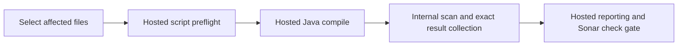

# Sonar check

PRs targeting `main` or `release/26.12` run automatically on new commits. Title
and target changes refresh selection; body-only edits do not restart scans. The release
change reaches `main` through the existing auto-merge workflow, which activates
GitHub's trusted `pull_request_target` entry point.

The stable **Sonar check gate** starts pending on the exact PR head. Short gate
updates serialize separately from scans, so a title edit resets the gate without
interrupting an active analysis. Older runs cannot replace a newer gate. A title
CI-skip marker or an unaffected diff produces `skipped`, which does not block a required
check. Selected scans must finish successfully; missing evidence fails. Clean
passes create no PR comment. Advisory findings receive a summary; High/Blocker or
quality-gate failures receive a failing result and findings summary. Infrastructure
failures do not create comments.

## Affected files

[sonar-paths.json](../../sonar-paths.json) is shared by selection and scanner
inclusions. Selection checks the complete PR diff, including old/new rename paths
and deletions. It includes Java/Scala, C/C++ and headers, supported script languages,
XML/HTML, Dockerfiles, GitHub Actions workflows and configuration formats covered
by the server's Text/secrets analyzer (including properties, PEM/key files and
`.env`). The scanner also analyzes Java tests and excludes vendored dependencies and generated build output.

The current server has no Markdown analyzer. Plain documentation, CUDA `.cu`/`.cuh`,
and generic JSON/YAML are outside this code-analysis list; workflow YAML has its
own enabled analyzer. Update the catalog when enabling another analyzer. Script
preflight is a separate heuristic check, not proof that source is safe to execute.

## Operation

- Helpers come from the trusted workflow revision. PR Maven code runs only on a
  disposable hosted runner with read-only permissions and Actions cache access
  disabled. Internal runners receive source/classes as data and use trusted scanner settings and fresh scratch space.
- Same-PR scans serialize through server processing and result collection. New
  requests do not abort an executing scan; GitHub may replace older pending work.
- Reuse `SONAR_HOST_URL` and `SONAR_TOKEN`; set `SONAR_PROJECT_KEY` to the existing
  JNI project. The token needs Execute Analysis and the collector's read access.
  The gate must include new High and Blocker counts, both `GT 0`.
- `SONAR_BUILD_JAVA_VERSION` optionally overrides the hosted Java 17 default.
  Scanner tooling remains in the reviewed internal runner image.
- Keep the internal pool for trusted scans, never PR builds. Its existing two-slot
  rotation and recovery stay unchanged. Existing merge rules stay unchanged until
  **Sonar check gate** is explicitly made required after rollout validation.
