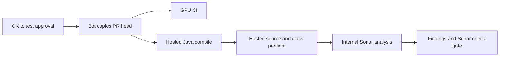

# Sonar check

Sonar uses GPU CI's existing copy-PR approval flow. A maintainer comments
`/ok to test <full-head-SHA>`; the bot updates `pull-request/<number>` and that
push starts both workflows. Automatic copying is disabled. Opening a PR or
pushing a new commit alone does not start Sonar; each new head needs approval.
Verify the copied SHA: the bot's trusted-contributor policy may copy the latest
head rather than the SHA written in the command.

The workflow verifies that the copied SHA is still the open PR's current head,
and supports `main` and `release/26.12`. It rechecks the selected head and target
before scanning and before passing the native **Sonar check gate**. Same-PR scans
serialize through result collection; newer requests do not abort an active scan.
Title/base edits alone do not create a copied push. Rerun the existing approved
workflow to apply them; a new head needs another approval.

## Results

| Result | Gate | PR comment |
| --- | --- | --- |
| Title CI-skip or unaffected diff | Skipped | None |
| Clean analysis | Success | None |
| Non-blocking findings | Success | Findings summary |
| High/Blocker issues or failed quality gate | Failure | Findings summary |
| Compilation, infrastructure or reporting error | Failure | None |

[sonar-paths.json](../../sonar-paths.json) drives selection and scanner inclusions.
Selection checks the full diff, including deleted/renamed paths. Supported files
include Java/Scala, C/C++ and headers, scripts, XML/HTML, Dockerfiles, workflow YAML
and enabled Text/secrets formats. Vendored dependencies and generated output are
excluded. Markdown, plain documentation, CUDA `.cu`/`.cuh`, and generic JSON/YAML
are outside the current analyzer list. Update the catalog when enabling analyzers.

## Configuration and trust

- Reuse `SONAR_HOST_URL` and `SONAR_TOKEN`; set `SONAR_PROJECT_KEY` to the existing
  JNI project. Its quality gate must reject new High and Blocker issues.
- `SONAR_BUILD_JAVA_VERSION` optionally overrides hosted Java 17. Scanner tooling
  stays in the existing internal runner image and pool.
- Hosted compilation shares GPU CI's Maven cache key and archive path. It restores
  the copied PR's cache first, then the existing main baseline, and saves updates
  only under that copied PR branch. No Sonar post-merge warmer or schedule is added.
  Only dependencies are cached; misses use normal downloads. Other Sonar jobs
  have cache access disabled. Keep the explicit archive path aligned with GPU CI.
- Approval covers the copied workflow and helper code. Maven runs on a disposable
  hosted runner with read-only repository access and no Sonar credentials.
  The fresh hosted preflight rejects source symlinks and unsafe class
  artifacts before internal analysis. Internal scanning reads source/classes as
  data and uses approved scanner settings with step-scoped Sonar credentials.
- This uses the same approval model as GPU CI. Runner labels are not access
  controls for other workflows; the bot does not make the repository pool
  exclusive to Sonar. Script preflight is heuristic, not proof of safe code.
- Backport these files to the release branch; existing auto-merge carries them to
  main. Validate the approved-copy scan and native gate before making
  **Sonar check gate** required. Existing merge rules are unchanged.
